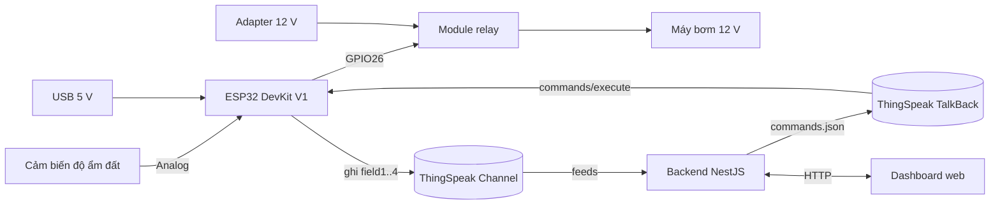

# Hệ thống tưới cây tự động theo độ ẩm đất (ESP32 + ThingSpeak)

ESP32 đọc độ ẩm đất, tự bật/tắt máy bơm theo ngưỡng 30 % / 60 %, gửi dữ liệu lên ThingSpeak và nhận lệnh điều khiển từ dashboard web qua **ThingSpeak TalkBack**.

## Sơ đồ khối



| Khối | Chức năng |
|---|---|
| Cảm biến độ ẩm | Chuyển độ ẩm đất thành điện áp analog |
| ESP32 | Đọc ADC, quyết định bật/tắt bơm, giao tiếp WiFi |
| Relay | Cách ly mạch điều khiển 3.3 V với mạch công suất của bơm |
| Máy bơm | Cấp nước cho cây |
| ThingSpeak Channel | Lưu dữ liệu do ESP32 gửi (chỉ ESP32 ghi) |
| ThingSpeak TalkBack | Hàng đợi lệnh từ dashboard tới ESP32 |
| Backend NestJS | Che API key; `GET /api/status`, `GET /api/history`, `POST /api/pump/mode` |
| Dashboard | Hiển thị trạng thái, biểu đồ lịch sử, cảnh báo lỗi, gửi lệnh đổi chế độ |

## Linh kiện

| STT | Linh kiện | Thông số chính |
|---:|---|---|
| 1 | ESP32 DevKit V1 | Dual-core 240 MHz, WiFi 2.4 GHz, ADC 12-bit |
| 2 | Cảm biến độ ẩm đất kiểu điện trở (đầu dò + module LM393) | 3.3–12 V, ngõ AO (analog) và DO |
| 3 | Module relay 2 kênh 5 V có opto | Tiếp điểm 10 A/30 VDC, ngõ vào TTL, jumper HIGH/LOW trigger |
| 4 | Máy bơm mini 12 V DC | 0.6–2 A, 1.8 L/phút |
| 5 | Adapter 12 V DC ≥ 2 A | Nguồn cho bơm |
| 6 | Cáp USB 5 V | Nguồn ESP32 + nạp code + Serial |
| 7 | Dây, breadboard, ống nước | |

## Đấu dây

| Từ | Đến | Ghi chú |
|---|---|---|
| Cảm biến VCC | ESP32 3V3 | Cấp 3.3 V để AO không vượt giới hạn chân ADC |
| Cảm biến GND | ESP32 GND | |
| Cảm biến AO | **GPIO36 (VP)** | ADC1 — ADC2 không dùng được khi bật WiFi |
| Cảm biến DO | Không nối | Ngưỡng xử lý bằng phần mềm |
| Relay VCC | ESP32 VIN (5 V) | |
| Relay GND | ESP32 GND | |
| Relay IN1 | **GPIO26** | |
| Jumper relay | **HIGH Trigger** | Lúc boot GPIO26 ở mức thấp → bơm giữ tắt |
| Adapter 12 V (+) | Relay COM1 | |
| Relay NO1 | Bơm (+) | Thường mở: mất điện điều khiển → bơm tắt |
| Bơm (−) | Adapter 12 V (−) | Mạch 12 V tách riêng, không chung mass với ESP32 |

## Cấu hình ThingSpeak

1. **Channel**: tạo channel với 4 field:

   | Field | Nội dung | Giá trị |
   |---|---|---|
   | 1 | Độ ẩm đất (%) | 0–100; để trống khi cảm biến lỗi |
   | 2 | Trạng thái bơm | 0 = tắt, 1 = chạy |
   | 3 | Chế độ hiện tại | 0 = AUTO, 1 = MANUAL_ON, 2 = MANUAL_OFF |
   | 4 | Mã lỗi | 0 = bình thường, 1 = cảm biến lỗi, 2 = bơm chạy không hiệu quả |

   Lấy *Channel ID*, *Write API Key*, *Read API Key* ở tab **API Keys**.
2. **TalkBack**: *Apps → TalkBack → New TalkBack* (không cần liên kết channel). Ghi lại *TalkBack ID* và *API Key* của TalkBack.
   Lệnh hợp lệ: `AUTO`, `ON`, `OFF`.

## Firmware (PlatformIO)

```bash
cp include/secrets.h.example include/secrets.h
# điền WiFi, Channel ID, Write/Read API Key, TalkBack ID/API Key
pio run -t upload
pio device monitor        # 115200 baud
```

`include/secrets.h` nằm trong `.gitignore` — không commit file này.

### Hằng số chính (`src/main.cpp`)

| Hằng | Giá trị | Ý nghĩa |
|---|---|---|
| `ADC_DRY` / `ADC_WET` | 3300 / 1500 | Mốc hiệu chuẩn: đầu dò ngoài không khí / nhúng nước (đo lại với cảm biến thật, xem log `[Sensor] ADC raw`) |
| `MOISTURE_LOW` / `MOISTURE_HIGH` | 30 / 60 % | AUTO bật bơm khi < 30 %, tắt khi ≥ 60 % |
| `SEND_INTERVAL_MS` | 20 s | Chu kỳ gửi dữ liệu (gửi sớm hơn, tối thiểu 15.5 s, khi chế độ đổi) |
| `READ_INTERVAL_MS` | 5 s | Chu kỳ hỏi lệnh TalkBack |
| `MANUAL_ON_MAX_MS` | 5 phút | Bật thủ công quá thời gian này → tự về AUTO |
| `AUTO_ON_MAX_MS` / `AUTO_MIN_RISE` | 3 phút / 5 % | AUTO bơm 3 phút mà ẩm tăng < 5 % → tắt bơm, báo lỗi 2 |
| `OFFLINE_FALLBACK_MS` | 60 s | Mất WiFi quá lâu khi đang ở chế độ thủ công → về AUTO |
| `WDT_TIMEOUT_S` | 30 s | Watchdog: treo quá 30 s → ESP32 tự reset |
| `DEBUG_TIMING` | 1 | In log đo thời gian (`[T] ...`); đặt 0 cho bản nộp |

### Hành vi an toàn

- **Mất WiFi**: không chặn — đọc cảm biến và điều khiển bơm vẫn chạy mỗi giây; tự reconnect mỗi 10 s.
- **Cảm biến lỗi** (ADC ngoài `[ADC_WET − 300, ADC_DRY + 300]`): AUTO tắt bơm, gửi mã lỗi 1.
- **Bơm không hiệu quả** (hết nước, tắc ống): tắt bơm, gửi mã lỗi 2; lỗi được giữ cho tới khi dashboard gửi một lệnh bất kỳ.
- **Treo** (VD request HTTP kẹt): watchdog reset; relay khởi tạo LOW nên bơm tắt.

### Log đo thời gian (`DEBUG_TIMING 1`)

| Log | Dùng để đo |
|---|---|
| `[T] loop t=… dt=…` | Chu kỳ loop |
| `[T] write_fields … ms` / `[T] talkback_execute … ms` | Thời gian 1 request |
| `[T] mode_change … t=…` | Độ trễ lệnh từ xa (so với lúc bấm nút trên dashboard) |
| `[T] pump_on/pump_off t=…` | Độ trễ điều khiển cục bộ |
| `[T] setup_done t=…`, `[T] first_write_ok t=…` | Thời gian khởi động |

## Dashboard (NestJS)

```bash
cd dashboard
cp .env.example .env      # điền CHANNEL_ID, READ_API_KEY, TALKBACK_ID, TALKBACK_API_KEY
npm install
npm run start:dev
```

Mở `http://localhost:3000`.

| API | Mô tả |
|---|---|
| `GET /api/status` | Trạng thái mới nhất (độ ẩm, bơm, chế độ, mã lỗi, thời gian) |
| `GET /api/history?results=N` | N điểm gần nhất (1–8000, mặc định 100) |
| `POST /api/pump/mode` | Body `{ "mode": 0 \| 1 \| 2 }` — đưa lệnh `AUTO`/`ON`/`OFF` vào hàng đợi TalkBack |
